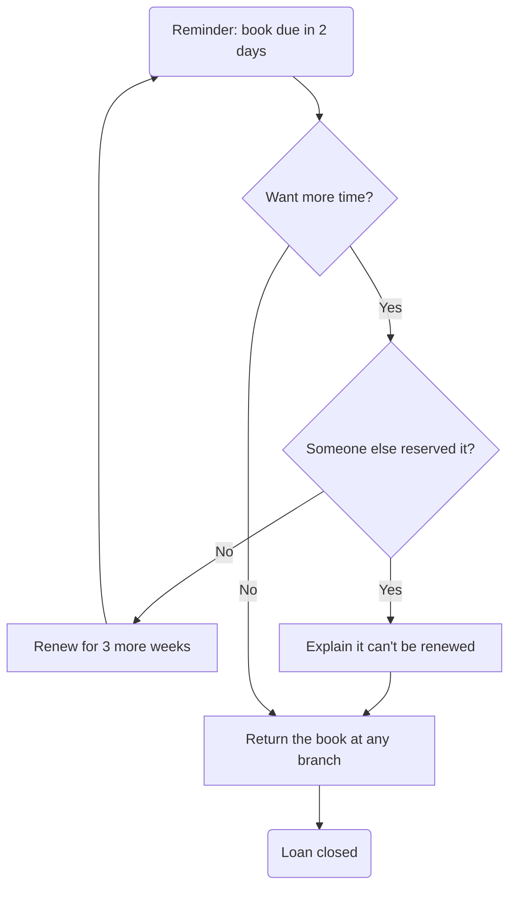

# Flowchart – Return a book

*Made-up content for the Shelfie demo.* Based on use cases 3 and 4, and issues #3, #4.

---
💬 **Comment on this flow:** [#3 Renew a loan](https://github.com/saanchi365/wiki-pages-demo/issues/3) · [#4 Reminder before due](https://github.com/saanchi365/wiki-pages-demo/issues/4)
